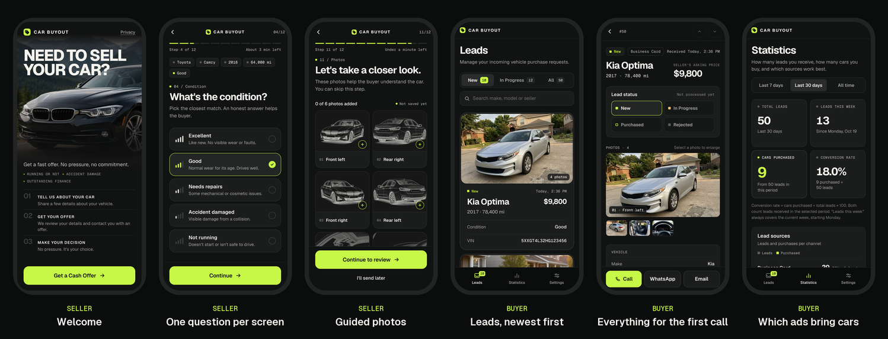

# The business

Who buys this system, what you sell, what to charge, where the clients are,
and the other niches and countries it fits. The short version is in the
[README](../README.md).

## Who buys it

Businesses that buy used cars straight from private sellers:

- cash-for-cars and "we buy any car" buyers;
- junk and salvage car buyers;
- small used car lots and independent dealers;
- wholesalers and people who flip cars.

How many there are depends on the area: count the cards under wipers, the
road signs and the map listings where you live. The best client already hands
out cards or puts up signs: they already spend on getting sellers, and a code
reaches people who would not call.

## What you sell

A done-for-you lead system under the buyer's own name. Many people who find a
card under their wiper or see a sign would rather not call a stranger, calls
come at odd hours, and each one starts with the same questions. With a QR code
or a link the seller answers those questions in a few minutes and leaves their
contacts, and the owner gets a push, usually within seconds, so they call
first. The car (make, model, year and mileage) is always in the lead; photos
and the asking price are there when the seller adds them.

You build it with Claude Code on your Railway account and hand it over to the
client's own: Railway and the domain are in the client's name and on the
client's card, so it keeps working whatever happens between you. You charge
for the setup and, if they want it, for support. Some cities and private lots
restrict leaving flyers on cars, so the client should check the local rules.

## What the business gets

- **Windshield cards with a QR code** on both sides: business-card size (3.5 x 2 in in the US), made
  to be left under wipers, generated in their color with their logo and
  phone. A print-ready PDF (bleed, CMYK) for any print shop. A QR code or a
  link for every other place sellers see, each counted separately (below).
- **A form for sellers** that collects the year, make, model, mileage,
  condition, accident and loan history, asking price, location, VIN, contact
  details and guided photos. A few minutes on a phone. A seller who stops
  halfway is not lost: the lead is saved as soon as the contact step is done.
- **A push notification** to the owner's phone for every new lead, usually
  within seconds. iPhone and Android.
- **An app on the owner's phone**: leads by status (New, In Progress,
  Purchased, Rejected), photos, notes, a one-tap call and a second button
  for the way the seller asked to be reached (a text, WhatsApp or email), and
  statistics: how many sellers came and how many cars were bought, from
  each place.
- **Their own brand and their own accounts**: their name, color, logo and
  domain, hosted on their own Railway account for about $5 a month, their
  data in their own database.
- **Privacy built in**: a privacy policy template, a consent checkbox, and
  sellers' names, phones and photos erased automatically 90 days after a lead
  is closed.

## Where leads come from

A card under a wiper comes first. Every other place gets its own QR code
(printed) or link (online), and statistics show how many sellers and bought
cars each one brings:

- **A card under a wiper**: the card's own code.
- **A sticker on the buyer's own car**: seen in traffic and parking lots.
- **A poster at a partner repair shop or tow company**: one code per
  partner, so each one's sellers are counted.
- **A sign or banner**: a large code for people who stop, and the address in
  large letters (a typed address counts as Other).
- **A link in the Google Maps listing** (Yandex Maps in Russia): in the
  website field.
- **A link in the social profiles and local groups**: in the bio, and in
  posts in neighborhood and car groups.

## Pricing

Suggested starting points, not market-tested yet.

| | Price | What it covers |
|---|---|---|
| Setup | $300-600 once | Turnkey: installation, their name, color and logo, connecting their domain, the app on the owner's phone, the card PDF, and QR codes and links for every place. |
| Support (optional) | $25-50 a month | Changes to the questions, new QR placements, updates, someone to call. |
| Hosting | about $5 a month | On the client's own card. Where Railway doesn't fit (Russia), a small server in the client's country, at a similar price. |
| Domain | about $10-15 a year | Required, in the business's name. Free if the business has a website: use a subdomain such as `buy.<their domain>`. |
| Printing | usually under $150 per 1,000 cards | Any print shop; the PDF is print-ready. |

Hosting, the domain and printing are paid by the client directly, on top of the setup price.

Hosting is Railway's Hobby plan, $5 a month with $5 of usage included. In practice
instances like this fit within Hobby's included usage; check the first client's bill.

You pick the price within the range, and whether to sell the setup alone or
with monthly support. Your own fixed costs are a paid Claude plan for Claude
Code and your own Railway Hobby plan, $5 a month: each instance is built there
before it is handed over.

The argument for the owner is arithmetic, not a promise: if a car earns them
a few hundred dollars, one extra car from the system pays for the setup.
Whether it brings one, the first weeks will show.

## Finding clients

- "We buy cars" cards under windshield wipers, and road signs with a phone
  number.
- Google Maps: "we buy cars", "cash for cars", "junk car buyer" with a city
  name.
- Facebook Marketplace and local groups: accounts that post "we buy cars, any
  condition".
- Craigslist: "we buy" posts in cars and trucks.
- Tow companies, repair shops and junkyards: they know every buyer in town.

When you talk to one, send them [the page for car buyers](https://car-buyer-demo.github.io/) with their
name and color in the link (`?name=Rapid+Cash+Cars&color=ff8a00`, or the
link maker on the project page): a live demo of the form and the app in
their own look, with no prices or setup details on it.

## Other niches

At its core the system is a questionnaire with photos, an instant
notification and an app to work the leads. How much of it changes for
another niche depends on how close the thing is to a car.

### Vehicles (form settings only)

The questions are a preset file, the wording a texts file and the photo
slots a list. A lead is titled by its make and model, with the year and
mileage under it, so anything bought by make and model fits with no change
to the app:

| Niche | The form asks | Photos |
|---|---|---|
| Junk and scrap cars | Running or not, title, pickup address | The car, the damage |
| Motorcycles, boats, RVs, trailers | Make, model, year, miles or engine hours, title | A walkaround |
| Trucks and heavy equipment | Make, model, year, hours, maintenance, location | The machine, the hour meter |

Engine hours or a boat's hull number are questions of their own: they show
in the lead, not on its card in the list. The photo guides are sketches of a
car; another photo slot shows none until a sketch of its own is added to the
app. To adapt it, tell Claude Code what the business buys, for example:
*"Adapt this system for a business that buys motorcycles. Ask for make,
model, year, mileage, title status and photos of both sides and the
dashboard."*

### Other things (needs changes to the app)

| Niche | The form asks | Photos |
|---|---|---|
| "We buy houses" investors | Address, condition, timeline, mortgage | Rooms, roof, problems |
| Phones, electronics, appliances | Model, condition, accessories | Front, back, screen |
| Repair and service quotes: auto body, roofing, junk removal | The problem, address, urgency | The damage, the job |

The lead cards and the lead's fields are built around a car (make, model,
year and mileage, also in the notification's title), so they have to change.

## Other countries

The system is adapted to another country during setup: the sellers'
language, the questions, the privacy policy and the card's size. The legal
side is for the business's local lawyer to check. Ready files for several
countries are in [countries/](../countries/); see
[SETUP.md](../SETUP.md#another-country).
