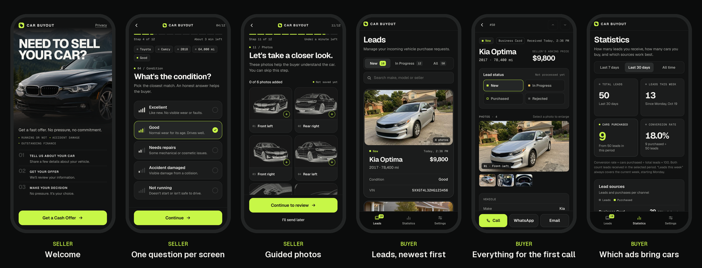

# The business

Who buys this system, what you sell, what to charge, where the clients are,
and the other niches it fits. The short version is in the
[README](../README.md).

## Who buys it

Businesses that buy used cars straight from private sellers:

- cash-for-cars and "we buy any car" buyers;
- junk and salvage car buyers;
- small used car lots and independent dealers;
- wholesalers and people who flip cars.

How many there are depends on the area: count the cards under wipers, the
road signs and the map listings where you live. The best client already hands
out cards or puts up signs: they already spend on getting sellers, and a code
reaches people who would not call.

## What you sell

A done-for-you lead system under the buyer's own name. Many people who find a
card under their wiper would rather not call a stranger, calls come at odd
hours, and each one starts with the same questions. With a QR code the seller
answers those questions and sends photos in a few minutes, and the owner sees
the car before calling back.

You build it with Claude Code on your Railway account and hand it over to the
client's own: Railway and the domain are in the client's name and on the
client's card, so it keeps working whatever happens between you. You charge
for the setup and, if they want it, for support. Hosting, the domain and
printing are paid by the client directly. Some cities and private lots restrict leaving
flyers on cars, so the client should check the local rules.

## What the business gets

- **Windshield cards with a QR code** on both sides: business-card size (3.5 x 2 in in the US), made
  to be left under wipers, generated in their color with their logo and
  phone. A print-ready PDF (bleed, CMYK) for any print shop. Separate QR codes
  for road signs, flyers and ads, each counted separately.
- **A form for sellers** that collects the year, make, model, mileage,
  condition, accident and loan history, asking price, location, VIN, contact
  details and guided photos. A few minutes on a phone. A seller who stops
  halfway is not lost: the lead is saved as soon as the contact step is done.
- **A push notification** to the owner's phone for every new lead, within
  seconds. iPhone and Android.
- **An app on the owner's phone**: leads by status (New, In Progress,
  Purchased, Rejected), photos, notes, one-tap call, text or WhatsApp, and
  statistics: how many sellers came, how many cars were bought, from cards,
  signs or ads.
- **Their own brand and their own accounts**: their name, color, logo and
  domain, hosted on their own Railway account for about $5 a month (Railway
  Hobby, includes $5 of usage; not yet checked against a real client's bill),
  their data in their own database.
- **Privacy built in**: a privacy policy template, a consent checkbox, and
  sellers' names, phones and photos erased automatically 90 days after a lead
  is closed.

## Pricing

Suggested starting points, not market-tested yet.

| | Price | What it covers |
|---|---|---|
| Setup | $300-600 once | Turnkey: installation, their name, color and logo, their domain, the card PDF and QR codes for signs and ads, the app on the owner's phone. |
| Support (optional) | $25-50 a month | Changes to the questions, new QR placements, updates, someone to call. |
| Hosting | about $5 a month (Railway Hobby, includes $5 of usage; not yet checked against a real client's bill) | On the client's own card. Where Railway doesn't fit (Russia), a small server in the client's country, at a similar price. |
| Domain | about $10-15 a year | Required, in the business's name. Free if the business has a website: use a subdomain such as `buy.<their domain>`. |
| Printing | usually under $150 per 1,000 cards | Any print shop; the PDF is print-ready. |

You pick the price within the range, and whether to sell the setup alone or
with monthly support. Your own fixed costs are a paid Claude plan for Claude
Code and your own Railway Hobby plan, $5 a month: each instance is built there
before it is handed over.

The argument for the owner: if a car earns them a few hundred dollars or
more, one extra car a month pays for the whole thing.

## Finding clients

- "We buy cars" cards under windshield wipers, and road signs with a phone
  number.
- Google Maps: "we buy cars", "cash for cars", "junk car buyer" with a city
  name.
- Facebook Marketplace and local groups: accounts that post "we buy cars, any
  condition".
- Craigslist: "we buy" posts in cars and trucks.
- Tow companies, repair shops and junkyards: they know every buyer in town.

When you talk to one, send them [the page for car buyers](https://ilyaxxing.github.io/cash-for-cars-lead-system/for-buyers/) with their
name and color in the link (`?name=Rapid+Cash+Cars&color=ff8a00`, or the
link maker on the project page): a live demo of the form and the app in
their own look, with no prices or setup details on it.

## Other niches

At its core the system is a questionnaire with photos, an instant
notification and an app to work the leads. It fits anything that is bought,
or quoted, from a few phone photos:

| Niche | The form asks | Photos |
|---|---|---|
| Junk and scrap cars | Running or not, title, pickup address | The car, the damage |
| Motorcycles, boats, RVs, trailers | Make, model, year, miles or hours, title | A walkaround |
| Trucks and heavy equipment | Hours, maintenance, location | The machine, the hour meter |
| "We buy houses" investors | Address, condition, timeline, mortgage | Rooms, roof, problems |
| Phones, electronics, appliances | Model, condition, accessories | Front, back, screen |
| Repair and service quotes: auto body, roofing, junk removal | The problem, address, urgency | The damage, the job |

To adapt it, tell Claude Code what the business buys or quotes, for example:
*"Adapt this system for a business that buys motorcycles. Ask for make,
model, year, mileage, title status and photos of both sides and the
dashboard."* The questions are data (a preset file), the wording is a text
file and the photo slots are a list, so a new niche needs no new code.
For a business in another country, Claude Code adapts the system during
setup: the sellers' language, the questions, the privacy policy under that
country's law (a draft for the client's lawyer), the card's size, and a
server in the country where the law keeps personal data at home, as in
Russia ([SETUP.md](../SETUP.md#another-country)).
